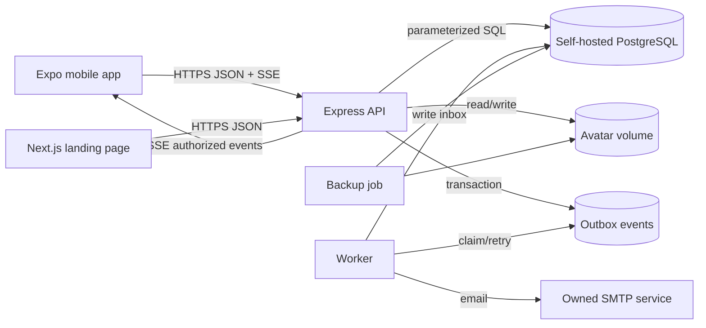
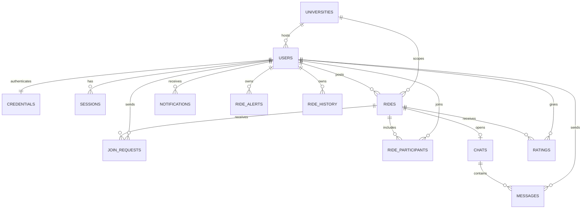
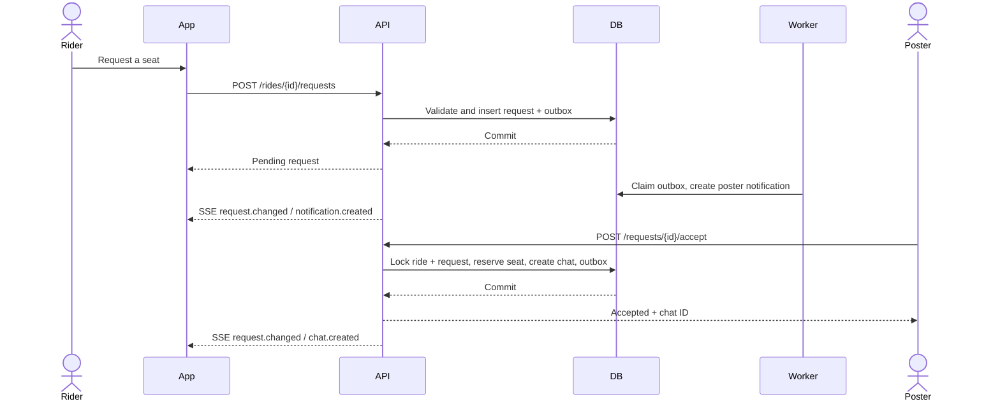

# RideShare: Supabase to owned Express backend migration

Status: planning, based on repository source inspected 2026-11-19. This is a build specification, not evidence that the deployed Supabase schema matches the checked-in migrations. See `SUPABASE_BACKEND.md` for the detailed current behavior inventory.

## 1. Scope and size

The repository has an Expo mobile app, a Next.js landing page, 25 checked-in Supabase SQL migrations (numbered 001–028 with gaps), and three Edge Functions. The mobile app uses Auth, PostgREST, Realtime, Storage, and push-related functions directly. The landing page writes a `waitlist` row and calls `get_waitlist_count`; neither object is defined in the checked-in migrations. No Express backend exists yet. Existing uncommitted mobile changes must be preserved.

**Estimate:** 12 workstreams, about 50 public API operations across 12 resource groups, 3 internal jobs, and 2 client migrations. This is a planning count; split/merge routes during contract review without changing the required behavior.

| Workstream | Requirement |
|---|---|
| 1. Discovery and backup | Export deployed schema, data, auth identities, storage objects, RLS, function and scheduler settings; reconcile with source. |
| 2. Runtime and operations | Express, configuration, health, database pool, migrations, logs, request IDs, rate limits, deploy, backup/restore. |
| 3. Identity | Signup, email verification, login, renewal, logout, recovery, password change, session revocation. |
| 4. Directory and profiles | Universities, own profile, avatar, blocking, deletion/export policy. |
| 5. Rides | Listing, detail, posting, expiry, cancel, completion, history. |
| 6. Requests and capacity | Request, withdraw, poster decision, participant state, atomic seat allocation. |
| 7. Chat | Authorized chat list, messages, read state, expiry and retention. |
| 8. Safety and trust | Server-owned PIN verification, ratings, trust score calculation. |
| 9. Notifications | In-app inbox, preferences, ride alerts, token handling decision, event stream. |
| 10. Waitlist | Anonymous signup and public count for landing page, abuse controls. |
| 11. Client conversion | Typed mobile API layer and landing-page API calls; retire direct Supabase access. |
| 12. Cutover | Import, reconciliation, release gates, rollback window, decommission. |

## 2. Technology choices and provider boundary

- Use Node LTS, TypeScript, Express, PostgreSQL and `pg` (a database driver), with handwritten parameterized SQL and SQL migration files. Use built-in `node:crypto` (`scrypt`, random bytes, timing-safe comparison), `node:fs`, `node:http`, and `node:test` where practical. Express and `pg` are packages, not hosted providers. Avoid ORM, hosted auth, hosted database, hosted realtime, managed object storage, and third-party analytics.
- Run Express and a small worker process against the same PostgreSQL database. Use an `outbox_events` table written in the same transaction as business state. The worker claims rows with `FOR UPDATE SKIP LOCKED`, retries with backoff, and records failure. This replaces Edge Functions and provides a reliable source for in-app notifications.
- Use server-sent events (`GET /events`) plus ordinary HTTP for foreground live updates. Node's HTTP stack supports SSE without a realtime package. Use `Last-Event-ID`, a durable event cursor, reconnect, and REST resync. For multi-instance delivery, a PostgreSQL `LISTEN/NOTIFY` wake-up may reduce polling, but durable outbox rows remain authoritative.
- Store avatars on an encrypted server volume with generated filenames, MIME and size validation, atomic writes and backup. Keep metadata in PostgreSQL. Serve only through an avatar route; never accept a client-supplied filesystem path. A later move to self-hosted S3-compatible storage can preserve the API contract.
- Send verification/reset email from an SMTP service under your control. A local MTA and a narrow SMTP library can be used; operating reliable email still requires DNS, TLS, SPF/DKIM/DMARC and delivery monitoring. Decide the actual mail transport before implementation.
- Strictly avoiding third-party providers means **no remote push notification service**. Foreground SSE and in-app inbox work, but reliable background iOS/Android push inherently goes through Apple/Google transport (and current code uses Expo Push). Product decision: accept foreground-only notifications, or approve direct APNs/FCM integration as a narrowly scoped platform dependency. Do not promise background push under a zero-provider rule.
- Keep existing PostHog, Vercel Analytics and Expo push usage in a separate provider-removal checklist if the instruction applies to the whole product, not just backend infrastructure.

## 3. Target architecture

Editable architecture drawing: [`architecture.drawio`](architecture.drawio). Diagrams below are also kept as text for review and version control.

Trust boundaries: public endpoints are waitlist, universities, and auth initiation; all ride, profile, chat, event and notification routes require a valid session. Database access is private to API/worker. Every record lookup applies a university, ownership, ride participant, or chat membership check in SQL/service logic. Never expose `password_hash`, OTP material, refresh-token hashes, raw safety PINs, or full push tokens in DTOs.

## 4. Data model and migration decisions

Preserve UUID identities and original timestamps where possible. Proposed owned schema: `universities`, `users`, `credentials`, `sessions`, `email_challenges`, `rides`, `join_requests`, `ride_participants`, `chats`, `messages`, `ratings`, `blocked_users`, `notification_preferences`, `notifications`, `ride_alerts`, `ride_history`, `avatar_files`, `waitlist`, `outbox_events`, `idempotency_keys`, `schema_migrations`. Keep `push_tokens` only if platform push is approved.

Required corrections before import: `users.password_hash` conflicts with app profile insertion and Supabase Auth; place new password hashes in `credentials`, and never assume Supabase password hashes are exportable. `chats` lacks client-used `requester_id`/`poster_id`; derive membership from accepted participants or model chat participants explicitly. `rides.closes_at` and `expires_at` overlap; choose one canonical `expires_at`. Confirm missing migration numbers 020/021/025 and deployed tables. `waitlist`/`get_waitlist_count` require a live schema audit. Change `ride_history` to unique `(user_id, ride_id)`. Change ratings trust recalculation to rated user only. Add `seats_taken <= seats_total`, unique membership/request constraints, normalized email uniqueness, indexes on feed and inbox queries, and explicit UTC timestamps.

Do not copy RLS as the sole security model. The Express service account can read tables; authorization must be enforced in routes/services and covered by cross-user/cross-campus tests. Consider PostgreSQL RLS as defense in depth after the application contract is stable.

## 5. API contract (`/api/v1`)

JSON responses use stable camelCase DTOs, ISO UTC timestamps, `data` and optional `page.nextCursor`. Errors use `{error:{code,message,requestId}}`. Use cursor pagination, bounded page sizes, `Idempotency-Key` for state-changing operations susceptible to retries, and `409` for stale transitions. All routes except those marked public require an access token. An opaque random access token with server-side hashed session record simplifies revocation; rotate opaque refresh tokens stored hashed and reuse-detect on refresh. Store mobile secrets in SecureStore. Set access TTL around 15 minutes and refresh TTL around 30 days, subject to product policy.

| Group | Method and path | Authorization and behavior |
|---|---|---|
| Health | `GET /health/live`, `GET /health/ready` | Operations; readiness checks DB. |
| Auth | `POST /auth/signup`, `POST /auth/verify-email`, `POST /auth/resend-code` | Public; rate limited. Signup stages email/profile, verification creates account/session. |
| Auth | `POST /auth/login`, `POST /auth/refresh`, `POST /auth/logout`, `POST /auth/logout-all` | Login public; refresh rotates token; logout revokes session(s). |
| Auth | `POST /auth/password/forgot`, `POST /auth/password/reset`, `POST /auth/password/change` | Forgot/reset public with single-use expiring code; change requires session. |
| Directory | `GET /universities` | Public; active universities only. |
| Profile | `GET /me`, `PATCH /me` | Own profile; whitelist editable fields. |
| Profile | `POST /me/avatar`, `DELETE /me/avatar`, `GET /users/:id/avatar` | Upload/delete own; public or scoped read policy to decide. |
| Blocking | `GET /me/blocked-users`, `POST /me/blocked-users`, `DELETE /me/blocked-users/:id` | Own list; prevent self-block; hide blocked parties from discovery/chat. |
| Rides | `GET /rides`, `GET /rides/:id` | Same university and visible/active status; filters, cursor pagination. |
| Rides | `POST /rides`, `GET /me/rides`, `POST /rides/:id/cancel`, `POST /rides/:id/complete` | Poster creates/cancels; completion authorized only by verified participants under explicit lifecycle rule. |
| Requests | `POST /rides/:id/requests`, `GET /rides/:id/requests`, `GET /me/requests`, `POST /requests/:id/withdraw`, `POST /requests/:id/accept`, `POST /requests/:id/decline` | Requester owns create/withdraw; poster owns decision; accept is one DB transaction. |
| Participants | `GET /rides/:id/participants`, `GET /me/participations` | Only poster/accepted participants; no raw PIN. |
| Safety | `POST /rides/:id/safety-pin/issue`, `POST /rides/:id/safety-pin/verify`, `GET /rides/:id/safety-status` | One PIN challenge per eligible participant, hash at rest, rate limit attempts; verification server-side. |
| Chat | `GET /chats`, `GET /chats/:id`, `GET /chats/:id/messages`, `POST /chats/:id/messages`, `POST /chats/:id/read`, `DELETE /messages/:id` | Accepted chat members only; sender may soft-delete own message. |
| Ratings | `POST /rides/:id/ratings`, `GET /users/:id/ratings` | Completed co-participants; one rating per pair/ride, public summary limited. |
| History | `GET /me/ride-history` | Own completed ride snapshots. |
| Notifications | `GET /me/notifications`, `POST /me/notifications/read`, `GET /me/notification-preferences`, `PATCH /me/notification-preferences` | Own durable inbox and preferences. |
| Alerts | `GET /me/ride-alerts`, `POST /me/ride-alerts`, `PATCH /me/ride-alerts/:id`, `DELETE /me/ride-alerts/:id` | Own alerts, campus derived from session. |
| Events | `GET /events` | Authenticated SSE: ride.changed, request.changed, chat.message, chat.read, rating.created, notification.created; authorize each event recipient. |
| Waitlist | `POST /waitlist`, `GET /waitlist/count` | Public; validation, honeypot/rate limits; count may be rounded/cached. |

Internal worker actions have no public route: expire rides, process outbox/in-app notifications/email, purge expired sessions/codes/chat content according to retention policy. If background push is approved, add `PUT /me/push-tokens` and `DELETE /me/push-tokens/:id` plus direct APNs/FCM dispatch.

### Key invariants

1. Request creation: authenticated same-campus user, not poster, not blocked, eligible gender policy, active unexpired ride, no accepted participation; allow retry only under a defined request state rule.
2. Acceptance: transaction locks ride and request, checks poster/capacity/status, inserts accepted participant, increments seats once, marks full if needed, creates/links chat, writes outbox events. Concurrent accepts cannot exceed capacity.
3. Completion: explicit policy for who can trigger it; at least one accepted non-poster rider, all required safety verifications, then one transaction updates ride/participants/counters/history and emits events. Repeated request returns prior outcome safely.
4. PIN: server generates random code; hash with a per-challenge salt; exchange/verification UX must be specified so one person cannot read the other's raw PIN from the API. Limit attempts and expiration.
5. Rating: only eligible completed ride participants can rate each other once; recalculate recipient aggregate in the same transaction; never accept rated user ID without pair validation.
6. No client invokes generic `send-notification`. Notifications arise from authorized domain actions and worker events.

## 6. Storyboards and user journeys

| Journey / storyboard | Screens or steps | API and event path | Success/edge case |
|---|---|---|---|
| Signup | University selection → details → email code → home | `/universities` → signup → verify → `/me` | Expired/reused code, duplicate email, non-campus email policy. |
| Returning user | Login → feed | login/refresh → `/me` → `/rides` → `/events` | Revoked session returns to login; cached content clears. |
| Post ride | Post form → confirmation → own ride | `POST /rides` → outbox → alerts/inbox → SSE | Retry returns same ride; expiry set server-side. |
| Find and join | Feed/filter → ride detail → request pending | `/rides` → `/rides/:id` → `POST /rides/:id/requests` | Full, expired, blocked, duplicate request shown clearly. |
| Poster accepts | Requests inbox → accept → chat | `/rides/:id/requests` → `POST /requests/:id/accept` → request/chat events | Last seat allocated once; decline/withdraw race gives conflict. |
| Coordinate | Chat list → messages → read | `/chats` → messages → `/events` → read | Disconnect uses cursor resync; no access after membership/retention expiry. |
| Meet safely | Ride detail → issue PIN → exchange verbally → enter partner PIN | safety issue → verify → safety status | Wrong PIN limited; no raw counterpart PIN fetched. |
| Finish and rate | Complete → rating → history | complete → rating → `/me/ride-history` | Idempotent completion; rating error never shown as success. |
| Alerts | Preferences → create route alert → new ride inbox | preferences/alerts CRUD → worker match → notification event | Muted category suppresses alert; campus isolation. |
| Landing waitlist | Email/form → success/count | `POST /waitlist`, `GET /waitlist/count` | Duplicate email returns safe response; consent recorded. |

## 7. Delivery phases and gates

| Phase | Deliverable | Exit gate |
|---|---|---|
| 0. Audit | Live schema dump, row counts, auth/export capability, storage and waitlist inventory, data map | Every source entity has a destination or documented deletion; backup restore tested. |
| 1. Foundation | `backend/` Express service, SQL migrations, CI checks, session/auth, health, logs | Local and staging deployment; auth abuse and authorization tests pass. |
| 2. Read APIs | Profile, universities, rides, history, waitlist read | Mobile/landing read paths compare against Supabase fixtures. |
| 3. Transactions | Rides, requests, participants, safety, rating | Race tests show no overbooking, duplicate history or rating. |
| 4. Communication | Chat, SSE, inbox, alerts, email, worker, avatar | Reconnect/resync and retry tests; no unauthorized event leakage. |
| 5. Import and clients | Import scripts, typed mobile API adapter, landing API integration | Counts/FKs/checksums sampled; all direct Supabase calls removed from both clients. |
| 6. Cutover | Staged release, final delta import or short write freeze, DNS/config switch | Error rate and key user journeys healthy; rollback rehearsal complete. |
| 7. Retire | Revoke Supabase keys, remove SDK/env/secrets/functions after retention window | Backup held for agreed retention; no production traffic to Supabase. |

Cutover should use a short write freeze unless a tested dual-write/delta mechanism exists. Export order: universities → identities/profiles → rides → requests/participants/chats/messages → ratings/history → notifications/preferences/alerts → avatars → waitlist. Import with preserved IDs, fix foreign keys, rebuild indexes, then compare counts and representative records. Existing Supabase Auth password hashes may be unavailable: use forced password reset/verification, never invent or copy plaintext credentials. Rollback means restoring prior client API configuration while Supabase remains writable; if new-backend writes occurred, reconcile them before switching back.

## 8. Open decisions that affect implementation

1. Is the Supabase database already migrated to a self-hosted PostgreSQL instance, or does data still need exporting? Provide a read-only production schema dump before finalizing SQL.
2. Should signup require university-domain email, or can non-domain users join with a warning (landing FAQ says the latter)? Define `verified` precisely.
3. Is foreground-only notification acceptable under the no-provider rule, or may the app use direct APNs/FCM for background delivery?
4. Who can complete a ride, and does every accepted rider need PIN verification? Current UI/RPC rules should be reconciled.
5. Should a declined/withdrawn request be re-openable? Decide whether a ride has one shared chat or separate rider/poster chats, especially for multi-seat rides.
6. What are message, avatar, waitlist and account deletion retention periods? Define backups and recovery objectives.
7. Which SMTP host will send account mail, and who operates DNS/deliverability?

## 9. Source map

- Mobile integration: `mobile-app/lib/supabase.ts`, `context/AuthProvider.tsx`, `store/rideStore.ts`, hooks under `mobile-app/hooks/`, screens under `mobile-app/app/`.
- Landing integration: `landing-page/app/page.tsx`, `landing-page/lib/supabase.ts`.
- Schema and server logic: `supabase/migrations/*.sql`, `supabase/functions/{send-notification,notify-new-ride,cancel-expired-rides}/index.ts`.
- Existing inventory: `SUPABASE_BACKEND.md`. Checked-in migration gaps and missing waitlist definition are verified repository observations; deployed data and schema remain to be audited.

## 10. Development order, module ownership and packages

Build one **modular Express application** first. Each feature owns its router, service, SQL repository, DTO mapping and tests under `backend/src/modules/<feature>/`. A module may call another module's public service, but must not import its repository or update its tables directly. Share only `backend/src/platform/` (database, auth middleware, errors, event writer, validation helpers) and `backend/src/contracts/` (API DTOs and event names). Express routers are designed for mountable feature modules; `pg` provides a pool, but all statements in one transaction must use the same checked-out client. [Express routing](https://expressjs.com/en/guide/routing/), [node-postgres pooling](https://node-postgres.com/features/pooling), [node-postgres transactions](https://node-postgres.com/features/transactions).

Packages below are **incremental additions**, not a package per module. The baseline backend installation is `express`, `pg`, `typescript`, `@types/node`, `@types/express`, and `@types/pg`; use the pinned Node release's built-in libraries for crypto, HTTP/SSE, filesystem, timers, and tests. Package versions should be chosen and locked when the backend is initialized. No hosted backend provider or ORM is needed. For email, an SMTP client package such as `nodemailer` is optional; a self-operated SMTP server is still required. [Node test runner](https://nodejs.org/api/test.html).

| Order | Part and owner folder | Depends on | Build and finish before the next part | New packages |
|---|---|---|---|---|
| 0 | **Schema audit and contracts** `backend/docs`, `backend/sql` | Live Supabase export | Confirm tables/columns, identity export, waitlist, retention, DTO names, error codes and event names. Freeze v1 contracts. | None; PostgreSQL CLI tools for export/import. |
| 1 | **Platform** `platform`, `db` | 0 | Express bootstrap, env checks, request IDs, JSON errors, DB pool, migrations, transaction helper, health, test DB, basic outbox runner and deployment skeleton. | `express`, `pg`, `typescript`, `@types/node`, `@types/express`, `@types/pg`; Node `node:test`. |
| 2 | **Universities and identity** `universities`, `auth` | 1 | University reads, credentials, OTP, queued SMTP mail, sessions, login/refresh/logout/recovery. Auth middleware becomes the shared entry point for private modules. | `nodemailer` + `@types/nodemailer` if using SMTP library; Node `node:crypto` for scrypt/random tokens, existing Expo SecureStore on mobile. |
| 3 | **Profiles and avatars** `users`, `avatars` | 2 | `/me`, profile edit, avatar metadata/upload/read/delete; define user/public DTO and university scope. | None on backend if using built-in filesystem + bounded upload parser; existing `expo-image-picker` and `expo-file-system` on mobile. If multipart parsing is chosen, add one maintained multipart package only here. |
| 4 | **Ride discovery and posting** `rides` | 2–3 | Feed/detail/create/own rides, server-side expiry values, status transition rules. Publish `ride.created/changed` through shared event writer. | None beyond baseline. |
| 5 | **Join requests and seats** `requests`, `participants` | 4 | Request/withdraw/accept/decline, lock-and-reserve transaction, capacity and participant membership. This module owns seat counter changes. | None beyond baseline. |
| 6 | **Chat** `chats` | 5 | Chat creation via accepted request, message list/send/read/delete, chat membership and retention. No direct chat creation from mobile. | None beyond baseline. |
| 7 | **Safety, completion and ratings** `safety`, `ratings`, `history` | 5–6 | PIN issue/verify, ride completion transaction, history snapshots, one rating per pair, trust recompute. Completion service owns completion state and counters. | Node `node:crypto`; no additional package. |
| 8 | **Worker expansion and notifications** `worker`, `notifications`, `alerts`, `events` | 4–7 | Extend the basic outbox runner with durable inbox, preferences, ride-alert matching, expiry jobs, SSE and reconnect. Earlier modules write outbox records; worker interprets them. | None for SSE/worker; reuse `pg` and `nodemailer`. Existing `expo-notifications` only if platform push is approved. |
| 9 | **Blocking and privacy** `blocks`, `privacy` | 3–8 | Block rules applied to discovery/request/chat, retention/deletion/export jobs. | None beyond baseline. |
| 10 | **Landing waitlist** `waitlist` | 1–2 | Public submission/count, consent, anti-abuse, replacement of direct landing-page Supabase calls. Can start after platform, but integrate after API contract freezes. | None beyond baseline; use browser `fetch`. |
| 11 | **Client migration and cutover** `mobile-app/lib/api`, landing page | Each corresponding API part | Replace client calls feature by feature in the same order: auth → profiles → rides → requests → chat → safety/rating → notifications → waitlist. Import data and cut over only after reconciliation. | Existing `expo-secure-store`; no new HTTP client required (`fetch`). Remove `@supabase/supabase-js` when no references remain. |

### How to avoid conflicts during development

1. **One owner per table/state transition.** `rides` owns ride creation/cancellation/expiry; `requests` owns seat allocation; `safety` owns PIN state; `completion` owns final ride/history/counter updates; `chats` owns messages. Other modules call the owner service.
2. **Freeze a contract before parallel feature work.** Commit `/api/v1` request/response examples and event payloads first. When a contract changes, update the contract and both client/server adapters in the same change.
3. **Keep migrations append-only.** Allocate a unique sequential migration number before starting a schema change. Never edit a migration already applied to a shared environment; add a corrective migration.
4. **Separate work by folder and gate.** A feature branch should change its own module, its own new SQL migration, contract fixtures and matching client adapter. Shared platform changes receive review before dependent branches build on them.
5. **Make integration gates explicit.** A part is complete when its endpoint contract, authorization checks, state-transition tests, and client screen flow pass against a local PostgreSQL database. Race tests are mandatory for seat allocation and completion.
6. **Keep Supabase and Express access behind one mobile adapter during rollout.** Route one feature at a time to Express; do not have both backends write the same resource unless a tested synchronization plan exists. Prefer a short write freeze at final cutover.

### Package/provider clarification

`express`, `pg`, TypeScript and an SMTP library are open-source packages running in your infrastructure. They do not host your data. The current app already has Expo packages for device features. Background mobile push still requires APNs/FCM transport even if Expo's push service is removed; Expo documents direct device-token access for that approach. [Expo direct push documentation](https://docs.expo.dev/push-notifications/sending-notifications-custom/).
